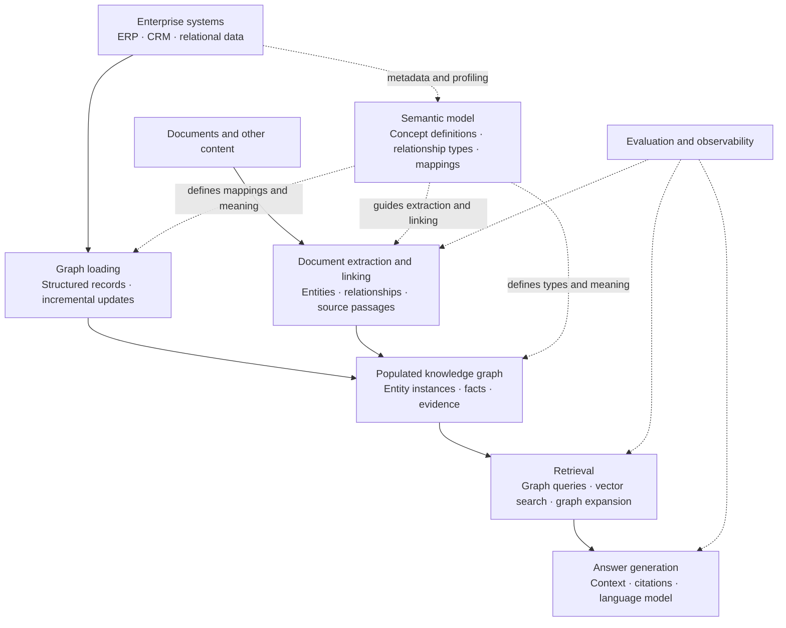

# GraphRAG Tools Landscape

A curated landscape of tools for building knowledge graphs, retrieving connected evidence, and generating grounded answers over enterprise data and documents.

**Research snapshot: 5 November 2026.** Includes GraphRAG frameworks, enterprise products, semantic-model discovery, graph loaders, graph databases, and selected supporting tools. Entries describe architectural roles, not a ranking.

## Contents

- [Scope and terminology](#scope-and-terminology)
- [Semantic models and knowledge graphs](#semantic-models-and-knowledge-graphs)
- [Landscape at a glance](#landscape-at-a-glance)
- [Graph construction and semantic discovery](#graph-construction-and-semantic-discovery)
- [GraphRAG frameworks and retrieval libraries](#graphrag-frameworks-and-retrieval-libraries)
- [Enterprise products and managed services](#enterprise-products-and-managed-services)
- [Graph storage and query engines](#graph-storage-and-query-engines)
- [Supporting tools](#supporting-tools)
- [Architecture patterns](#architecture-patterns)
- [Evaluation criteria](#evaluation-criteria)
- [Naming and lifecycle notes](#naming-and-lifecycle-notes)
- [Coverage and contribution method](#coverage-and-contribution-method)
- [Further reading](#further-reading)

## Scope and terminology

**GraphRAG** is used here as the broader family of retrieval-augmented generation approaches that use graph structure to select, connect, or summarize evidence for a language model. **Microsoft GraphRAG** is a particular implementation that extracts a graph from text, builds communities and summaries, and supports several search strategies. Other tools labeled GraphRAG may use substantially different methods. [Microsoft overview](https://microsoft.github.io/graphrag/), [Neo4j pattern catalog](https://graphrag.com/)

Three distinctions matter when reading this landscape:

| Distinction | Why it matters |
| --- | --- |
| Graph construction versus retrieval | A model discovery tool or graph loader supplies the knowledge foundation. A retriever selects evidence; generation produces the answer. Some products combine these roles. |
| Enterprise semantics versus text extraction | A graph derived from operational schemas and records has a different starting point from a graph extracted from documents. Both need identifiers, relationship definitions, and provenance. |
| Knowledge graph versus orchestration graph | A graph describing an agent workflow is not, by itself, a graph of domain knowledge used for retrieval. MCP provides a tool-access interface; it is not a retrieval algorithm. |

**Direct** entries explicitly document GraphRAG, graph-based retrieval, graph construction for AI, or an associated integration. **Supporting** entries provide a useful component, such as ontology editing, parsing, or evaluation. Their inclusion does not establish a turnkey GraphRAG capability.

The linked product pages, maintainer repositories, and official documentation are the evidence for factual descriptions. Architecture guidance and comparison questions are editorial synthesis. This is a research landscape, not an installation test or benchmark. Verify exact versions, licenses, deployment options, adapters, and operational guarantees before adopting a stack.

## Semantic models and knowledge graphs

The landscape distinguishes the **model that defines meaning**, the **graph that represents knowledge**, and the **engine that stores or queries it**. They are related, but they are different deliverables.

| Concept | Purpose and typical contents | Example |
| --- | --- | --- |
| **Semantic model** | Defines the meaning of concepts, attributes, relationship types, identifiers, and their mappings to source data. May include business rules and constraints. | Defines `Supplier`, `Contract`, and `SUPPLIES_UNDER`; explains which source fields identify a supplier and what an active contract means. |
| **Ontology** | A formal way to express domain concepts and relationships, potentially including logical axioms and inference semantics. A semantic model need not use an ontology language. | Defines `Supplier` as a kind of `Organization`, and the meaning of relationships between organizations and contracts. |
| **Knowledge graph** | Represents identifiable entities and their relationships, facts or assertions, and supporting context such as provenance and time. Can also contain the semantic model itself. | Represents supplier `S-104`, contract `C-882`, and the assertion that S-104 supplies under C-882, with source and validity information. |
| **Graph database or query engine** | Stores or exposes graph structures and executes queries over them. | Executes a query to find suppliers connected to active contracts. |
| **GraphRAG application** | Retrieves graph-derived evidence, assembles context, and generates an answer with supporting references. | Answers which suppliers are affected by a policy, citing contract records and policy passages. |

This is a distinction of roles, not a requirement for separate files or systems. A semantic model can itself be represented as a graph; a knowledge graph can combine schema, ontology, and instance-level facts. RDF Schema defines vocabulary for classes and properties, while OWL supports classes, properties, individuals, and logical axioms. Ontology reasoning and data validation are distinct capabilities. [W3C RDF Schema](https://www.w3.org/TR/rdf-schema/), [W3C OWL primer](https://www.w3.org/TR/owl2-primer/)

**Terminology varies by product.** In analytics, “semantic model” can also refer to dimensions, measures, and metric definitions. That label alone does not establish an ontology, a populated knowledge graph, or GraphRAG retrieval. Evaluate the actual artifact and behavior.

For this landscape, classify tools by what they produce or consume: **semantic definitions**, **populated graph data**, **graph queries**, or **retrieved evidence and answers**. Generating a semantic model does not by itself populate a graph; loading nodes and edges does not by itself establish shared business meaning.

## Landscape at a glance

| Layer | Function | Representative tools |
| --- | --- | --- |
| Semantic discovery and modeling | Define or derive concepts, relationship types, identifiers, meaning, and source mappings | Flow.BI, metaphactory, TopBraid EDG, Graphwise Graph Modeling |
| Knowledge graph construction and enrichment | Instantiate entities and relationships from records or documents; attach evidence and update graph data | LlamaIndex extractors, Neo4j LLM Knowledge Graph Builder, graph loaders |
| Ontology authoring | Express and maintain formal domain vocabulary and axioms | Protégé, TopBraid EDG, Graphwise Graph Modeling |
| Entity resolution | Reconcile records and mentions representing the same real-world entity | Senzing, framework-specific resolution components |
| Retrieval and generation frameworks | Graph traversal, vector/graph retrieval, community search, query generation, and answer synthesis | Microsoft GraphRAG, LightRAG, Neo4j GraphRAG, LlamaIndex, KAG, AWS GraphRAG Toolkit |
| Temporal graph memory | Maintain evolving facts and retrieve context for agents | Graphiti, cognee |
| Enterprise applications and managed services | Packaged graph-grounded assistants and managed GraphRAG workflows | Amazon Bedrock Knowledge Bases, Graphwise GraphRAG, Stardog Voicebox, metaphactory, TigerGraph |
| Graph storage and query | Persist or expose connected data and execute queries | Neo4j, Neptune, Spanner Graph, Cosmos DB for Gremlin, FalkorDB, Memgraph, ArangoDB, PuppyGraph |
| Parsing, evaluation, and observability | Prepare documents, measure evidence quality, and inspect runtime behavior | Docling, Unstructured, Ragas, DeepEval, Phoenix, Langfuse |



*The diagram illustrates functional roles rather than a particular vendor stack. Implementations may combine several roles in one product or compose separate tools.*

## Graph construction and semantic discovery

The entries below contribute different outputs: semantic definitions and mappings, populated graph data, or both through separate components. Discovery of entity types and relationship types should be assessed separately from extraction of entity instances and relationship assertions.

| Tool | Contribution | Dependencies and boundaries | Primary evidence |
| --- | --- | --- | --- |
| **Flow.BI** | Derives semantic definitions and source mappings from metadata and profiled data. Separate loaders populate and enrich a knowledge graph with structured records and document evidence. | Model review and downstream retrieval/generation remain part of the application workflow. The Apache-2.0 loaders `flowbi/ekg` and `flowbi/doc-ekg` are separate from the commercial product. | [Product](https://flow.bi/solutions/flow-bi-for-knowledge-graphs/), [structured loader](https://github.com/flowbi/ekg), [document loader](https://github.com/flowbi/doc-ekg) |
| **Neo4j LLM Knowledge Graph Builder** | Extracts entities and relationships from unstructured content, links document chunks, and provides graph exploration and GraphRAG-oriented search. | Neo4j-backed builder; inspect extraction schema, selected models, entity merging, and evidence quality. | [Official guide](https://neo4j.com/developer/genai-ecosystem/llm-graph-builder/) |

## GraphRAG frameworks and retrieval libraries

These are alternative or composable components, not equivalent implementations. Storage and model dependencies vary. Consult each repository's license for the exact version used.

| Tool / maintainer | Documented approach | Scope and evaluation notes | Primary evidence |
| --- | --- | --- | --- |
| **AWS GraphRAG Toolkit — awslabs** | Python toolkit with a lexical-graph approach for building graphs from unstructured content and a bring-your-own-knowledge-graph component. | Separate from managed Bedrock Knowledge Bases GraphRAG. Check the selected component, graph/vector backend, and model integration. | [Repository](https://github.com/awslabs/graphrag-toolkit), [AWS introduction](https://aws.amazon.com/about-aws/whats-new/2025/01/amazon-neptune-open-source-graphrag-toolkit/) |
| **cognee** | AI memory platform combining knowledge processing and retrieval over persistent context. | Overlaps GraphRAG and agent memory; assess graph/vector storage, ingestion, and retrieval configuration for the intended task. | [Repository](https://github.com/topoteretes/cognee) |
| **FalkorDB GraphRAG-SDK** | Ontology discovery, knowledge graph construction, retrieval, and agent orchestration on FalkorDB. | Distinguish the SDK, database, and packaged GraphRAG Server. Inspect ontology review and evidence returned with answers. | [SDK](https://github.com/FalkorDB/GraphRAG-SDK), [product architecture](https://www.falkordb.com/graphrag/) |
| **fast-graphrag — Circlemind** | Domain-guided graph construction and personalized PageRank-based graph exploration, with incremental inserts. | Independent of Microsoft's FastGraphRAG indexing method. Evaluate update behavior and answer references. | [Repository](https://github.com/circlemind-ai/fast-graphrag) |
| **Graphiti — Zep** | Temporal knowledge graphs tracking changing facts, provenance, and context for agents. | A temporal graph memory framework; not Microsoft's community-summary pipeline. Establish backend and operational requirements. | [Repository](https://github.com/getzep/graphiti) |
| **HippoRAG — OSU NLP Group** | Research framework combining retrieval, knowledge graphs, and personalized PageRank, inspired by long-term memory. | Research implementations and generations can differ; reproduce the chosen version's setup and evaluation protocol. | [Repository](https://github.com/OSU-NLP-Group/HippoRAG) |
| **KAG — OpenSPG** | Schema-constrained knowledge construction and logical-form-guided hybrid retrieval/reasoning over domain knowledge. | Depends on the OpenSPG ecosystem. Assess schema preparation, alignment, reasoning behavior, and language coverage. | [Repository](https://github.com/OpenSPG/KAG) |
| **LangChain graph integrations** | Components for graph-backed applications, including natural-language-to-Cypher querying and graph integrations. | A general application framework. The developer selects extraction, retrieval, access controls, and generation behavior. | [Neo4j integration](https://docs.langchain.com/oss/python/integrations/graphs/neo4j_cypher), [Neo4j ecosystem guide](https://neo4j.com/developer/genai-ecosystem/langchain/) |
| **LightRAG — HKUDS** | Entity/relationship graph indexing and graph/vector retrieval with local, global, hybrid, naive, and mixed query modes. | Supports incremental updates and selective document deletion. Mode names do not imply the same algorithms as Microsoft GraphRAG. | [Repository](https://github.com/HKUDS/LightRAG) |
| **LlamaIndex PropertyGraphIndex** | Composable graph extraction, storage, retrievers, and query engines for property graphs. | General framework with selectable extractors and graph-store integrations. Verify the exact store and retrievers; not all stores expose identical capabilities. | [Property graph guide](https://developers.llamaindex.ai/python/framework/module_guides/indexing/lpg_index_guide/) |
| **Microsoft GraphRAG** | Text-derived knowledge graphs, community detection and summaries, with local, global, DRIFT, and basic search. | MIT. Repository states it is largely in maintenance mode, with bug/dependency fixes rather than new features. Indexing and community summarization can be costly. | [Repository and lifecycle notice](https://github.com/microsoft/graphrag), [documentation](https://microsoft.github.io/graphrag/) |
| **nano-graphrag — gusye1234** | Compact GraphRAG implementation intended for inspection and customization. | Evaluate as a community implementation with its own storage and extension choices; do not infer production support from conceptual similarity. | [Repository](https://github.com/gusye1234/nano-graphrag) |
| **Neo4j GraphRAG for Python** | First-party Python package with knowledge graph building, retrievers, and RAG generation over Neo4j. | Requires a supported Neo4j deployment and configured models. Renamed continuation of the deprecated neo4j-genai package. | [Documentation](https://neo4j.com/docs/neo4j-graphrag-python/current/), [RAG guide](https://neo4j.com/docs/neo4j-graphrag-python/current/user_guide_rag.html) |

## Enterprise products and managed services

These offerings combine multiple layers. Commercial packaging, model access, infrastructure charges, and deployment requirements should be checked separately.

| Product | GraphRAG-related offering | Important boundary | Primary evidence |
| --- | --- | --- | --- |
| **Amazon Bedrock Knowledge Bases GraphRAG** | Managed graph construction and graph-enhanced retrieval using Neptune Analytics. | Document-driven managed workflow. Current documentation limits data sources to S3 and does not expose graph-build customization. Region and model availability apply. | [Current documentation](https://docs.aws.amazon.com/bedrock/latest/userguide/knowledge-base-build-graphs.html), [GA announcement](https://aws.amazon.com/about-aws/whats-new/2025/03/amazon-bedrock-knowledge-bases-graphrag-generally-available/) |
| **Graphwise GraphRAG** | Graph-grounded answers combining semantic modeling, graph queries, vector search, and conversational workflows. | Graph Modeling, formerly PoolParty, and GraphDB are components of the broader platform. Confirm release-specific dependencies and deployment packaging. | [GraphRAG documentation](https://help.graphwise.ai/gwp26-1/en/graphrag.html), [platform transition](https://help.graphwise.ai/en/graphwise-documentation/graphwise-sub-components-at-a-glance/poolparty-semantic-suite-to-graphwise-platform-transition-guide.html) |
| **metaphactory — metaphacts** | Semantic knowledge modeling and conversational interfaces supporting natural-language-to-SPARQL and unstructured RAG. | Semantic application platform; specify the graph backend and the services used for each question type. | [Product and conversational interface](https://metaphacts.com/solutions/products/metaphactory) |
| **Stardog Voicebox** | Conversational access to enterprise knowledge graphs with graph queries, document RAG, analysis, and source attribution. | Verify which agent produced each response and whether it used enterprise evidence or external model knowledge. | [Voicebox documentation](https://docs.stardog.com/voicebox/) |
| **TigerGraph GraphRAG** | Enterprise graph/vector retrieval and connected operational context, with solution kits and AI integrations. | Distinguish database capabilities, integrations, and the application being delivered. Validate the concrete retrieval implementation. | [GraphRAG offering](https://www.tigergraph.com/graphrag/), [MCP integration](https://www.tigergraph.com/docs/savanna/main/get-started/connect-agent-mcp) |
| **TopBraid EDG — TopQuadrant** | Semantic governance and GraphRAG foundations; documented features include content processing, vector search with SPARQL, and Python integration. | A semantic platform with GraphRAG-enabling features; confirm edition, release, corpus ingestion, and answer-generation components. | [EDG 9.0 feature documentation](https://ww2.topquadrant.com/release-note/9-0/) |

FalkorDB's packaged GraphRAG Server is covered with its SDK. Graphwise GraphDB and Graph Modeling, and Stardog's graph platform and Voicebox, are related layers of their respective stacks.

## Graph storage and query engines

A graph database or query engine supplies storage and traversal, but does not by itself establish extraction quality, retrieval relevance, answer grounding, or citation correctness.

| Platform | Architectural contribution | Compatibility notes / evidence |
| --- | --- | --- |
| **Amazon Neptune Database / Neptune Analytics** | Managed graph services used by GraphRAG toolkits and applications. | Distinct services and query/storage paths; a Neptune Database loader is not automatically a managed Bedrock Knowledge Bases integration. [AWS graph and AI](https://aws.amazon.com/neptune/graph-and-ai/), [toolkit resources](https://aws.amazon.com/neptune/resources/) |
| **ArangoDB / Arango** | Multi-model platform combining graph, document, vector, and search capabilities. | Confirm platform suite versus database scope and the retrieval/application components included. [Current product](https://arango.ai/) |
| **Azure Cosmos DB for Apache Gremlin** | Graph storage and Gremlin traversal for connected-data applications. | Keep this API distinct from Cosmos DB for NoSQL and other Cosmos graph/vector approaches. Check Gremlin compatibility and partitioning behavior. [Compatibility documentation](https://learn.microsoft.com/en-us/azure/cosmos-db/graph/gremlin-support) |
| **FalkorDB** | Graph query runtime underlying its GraphRAG SDK and Server. | Evaluate the database and application layers together. [GraphRAG architecture](https://www.falkordb.com/graphrag/) |
| **Google Spanner Graph** | Graph queries over a relational foundation, with graph/vector search and documented LangChain GraphRAG integration. | Check edition, SQL dialect, and feature availability; separate graph schema mapping from semantic model discovery. [Overview](https://docs.cloud.google.com/spanner/docs/graph/overview), [reference architecture](https://docs.cloud.google.com/architecture/gen-ai-graphrag-spanner) |
| **Memgraph** | Graph database and ecosystem for graph-backed retrieval and AI applications. | Inspect the specific GraphRAG integration, workload requirements, and update behavior. [GraphRAG overview](https://memgraph.com/graphrag) |
| **Neo4j / Aura** | Property graph database supporting Cypher, graph retrieval, and its GraphRAG package ecosystem. | Verify database edition, version, indexes, and the particular retriever; plain vector search alone is not graph expansion. [GraphRAG package and requirements](https://neo4j.com/docs/neo4j-graphrag-python/current/) |
| **PuppyGraph** | Queries relational data through a graph representation, providing an alternative to copying everything into a separate graph store. | Supporting query engine. Semantic mapping, entity reconciliation, retrieval, and generation still need an implementation. [Product](https://www.puppygraph.com/) |

GraphDB and Stardog also provide graph storage/query capabilities; their associated application stacks are described above. Database names appearing in a loader's target list are not a promise that every retrieval library supports those targets.

## Supporting tools

These are selected components, not an exhaustive list of every parser, model provider, vector store, or observability service.

### Ontology and identity

| Tool | Contribution | Boundary / evidence |
| --- | --- | --- |
| **Protégé / WebProtégé** | OWL ontology authoring and management, locally or collaboratively in a browser. | Supporting semantic tooling; application ingestion and GraphRAG retrieval are separate. [Project](https://protege.stanford.edu/) |
| **Senzing** | Entity resolution to reconcile fragmented records and reveal relationships. | Supporting identity layer. Record resolution and assigning semantic entity types are different tasks. [Product](https://senzing.com/) |

### Document preparation

| Tool | Contribution | Boundary / evidence |
| --- | --- | --- |
| **Docling** | Document parsing, structured representation, OCR options, and chunking for ingestion pipelines. | Supporting preparation; a parser does not define the enterprise ontology or validate extracted relationships. [Documentation](https://docling-project.github.io/docling/) |
| **Unstructured** | Document parsing and structured extraction through its tools and services. | Supporting preparation; verify product/API version, supported formats, and how provenance is carried into the graph. [Documentation](https://docs.unstructured.io/) |

### Evaluation and observability

| Tool | Contribution | Boundary / evidence |
| --- | --- | --- |
| **DeepEval** | Test framework for AI systems, with evaluation pipelines and custom criteria. | General evaluation tooling; graph correctness and path coverage require task-specific assertions. [Project](https://deepeval.com/) |
| **Langfuse** | Application tracing, prompt management, evaluation, and cost/latency inspection. | General observability; instrument graph queries, evidence selection, and model calls explicitly. [Documentation](https://langfuse.com/docs) |
| **Phoenix — Arize** | AI tracing, evaluation, and experiments, including local/self-hosted use. | General observability and evaluation rather than a GraphRAG engine. [Product](https://arize.com/phoenix/) |
| **Ragas** | Evaluation metrics for retrieval context, answer relevance, faithfulness, and related tasks. | General evaluation framework. Pair model-judged metrics with verified entity, relationship, and evidence tests. [Documentation](https://docs.ragas.io/en/stable/) |

## Architecture patterns

The following patterns are ways to organize a solution, not a statement that every named product implements every step.

| Pattern | Starting point and retrieval approach | Typical fit |
| --- | --- | --- |
| Document-derived community GraphRAG | Extract a graph from text, build communities/summaries, and retrieve local context or corpus-level summaries. | Questions about themes and connections across a document collection. Microsoft GraphRAG is a documented example. |
| Enterprise graph retrieval | Start from business concepts and integrated records; translate questions into graph queries or combine vector entry points with traversal. | Questions about customers, contracts, products, dependencies, and other operational relationships. |
| Hybrid structured and document graph | Link document chunks and assertions to enterprise identities, then retrieve records and supporting passages together. | Questions requiring both system facts and documentary evidence. |
| Temporal graph memory | Ingest events or episodes and retain when relationships or facts were valid. | Agents answering questions about changing context and previous interactions. Graphiti is a documented example. |
| Ontology-guided RDF retrieval | Use controlled vocabularies, explicit semantics, and SPARQL, optionally combined with vector search. | Domains requiring governed terminology, constraints, and semantic interoperability. |

For example, “Which suppliers connected to our active contracts are affected by this policy change?” may require enterprise identifiers and relationships plus policy-document evidence. A useful test asks whether the system connects the right suppliers and contracts, uses the current policy, and cites the passages supporting the answer. Good prose alone is insufficient evidence that retrieval worked.

## Evaluation criteria

Compare complete workflows using the same data, questions, model budget, and evidence requirements. Labels such as “global,” “hybrid,” and “agentic” are not standardized feature specifications.

| Dimension | Questions to resolve |
| --- | --- |
| Source coverage | Does it ingest documents, structured records, existing graphs, or a combination? Are connectors production-ready for your sources? |
| Semantic model | What concepts, relationship types, identifiers, definitions, and source mappings are explicit? Is an ontology used? How is the model discovered, authored, reviewed, and versioned? |
| Knowledge graph | Which actual entities, facts, assertions, evidence, and temporal context are populated? How are graph data checked against the semantic model, updated, and corrected? |
| Identity | How are aliases, shared business keys, duplicate records, ambiguous names, and cross-source identities reconciled? Can incorrect merges be reversed? |
| Relationship quality | Are edges source-backed facts, extracted assertions, inferred relationships, or co-occurrence? Can these types be distinguished during retrieval? |
| Retrieval | Does it use query generation, neighborhood expansion, path search, PageRank, community summaries, vector search, or a combination? |
| Existing graph support | Can the retriever consume your graph directly, or does it require its own schema, indexes, chunks, embeddings, and summaries? |
| Evidence | Can each answer claim be traced to records or passages, through a reproducible retrieval path? Does the citation actually support the claim? |
| Freshness and time | How are inserts, updates, deletes, source corrections, expired documents, and historical queries handled? |
| Access control | Are permissions applied before graph expansion and summarization? Can summaries or cached answers reveal otherwise inaccessible facts? |
| Abstention | Does the application identify insufficient or contradictory evidence and avoid unsupported answers? |
| Operational recovery | Can ingestion restart after partial failure? What is idempotent? How are stale graph edges, evidence, and embeddings removed? |
| Cost and latency | Measure extraction, graph loading, embeddings, community recomputation, retrieval, generation, and ongoing updates separately. |
| Deployment and portability | What requires a managed service? Can you change the graph database, models, embedding provider, or framework without rebuilding everything? |
| Maintenance and licensing | Check the specific release, license, commercial dependencies, lifecycle notice, and support agreement. |

A representative evaluation set should include:

1. Single-entity questions with verifiable answers.
2. Multi-hop questions whose answer requires relationships across sources.
3. Corpus-wide summary questions, where applicable.
4. Ambiguous names and duplicate identifiers.
5. Changed facts, superseded documents, and source deletes.
6. Questions with no supporting evidence.
7. Permission-restricted records and relationships.
8. Questions combining structured records with document evidence.

Measure retrieval and answer quality separately. Compare against a strong vector/keyword or SQL baseline; the additional graph work should produce a measurable benefit for the chosen workload. No universal performance ranking is asserted here.

## Naming and lifecycle notes

- **GraphRAG versus Microsoft GraphRAG:** the broader architectural term and the Microsoft implementation are distinct.
- **FastGraphRAG versus fast-graphrag:** Microsoft's fast indexing method and Circlemind's independent project are distinct. [Microsoft indexing methods](https://microsoft.github.io/graphrag/index/methods/)
- **Neo4j GraphRAG versus neo4j-genai:** the GraphRAG package continues the renamed package; official docs mark neo4j-genai deprecated. [Package documentation](https://neo4j.com/docs/neo4j-graphrag-python/current/)
- **PoolParty / Graphwise Graph Modeling:** current platform documentation describes the rebranding and consolidation. [Transition guide](https://help.graphwise.ai/en/graphwise-documentation/graphwise-sub-components-at-a-glance/poolparty-semantic-suite-to-graphwise-platform-transition-guide.html)
- **Microsoft GraphRAG lifecycle:** the repository explicitly describes maintenance mode. An accessible repository is not a commitment to new development. [Lifecycle notice](https://github.com/microsoft/graphrag)

## Coverage and contribution method

This landscape searches across the lifecycle rather than treating a framework list as the whole market: semantic discovery, identity, graph construction, storage, retrieval, generation, evaluation, and operations. It includes document-first and structured-data-first approaches. Coverage remains broad rather than guaranteed exhaustive.

For each refresh:

1. Search every layer independently and follow official partner/integration links.
2. Record candidate tools as included, supporting, duplicate/alias, excluded, or evidence pending.
3. Require primary evidence for the described role; separate a product page from a tutorial or research prototype.
4. Review the actual ingestion/retrieval boundary and avoid counting a database, SDK, and hosted edition as equivalent independent systems.
5. Verify names, licensing, lifecycle, and dependency changes; record the review date.
6. Avoid unverified accuracy claims, vendor speed comparisons, popularity rankings, or implied interoperability.

Suggested entry fields:

```text
Name and maintainer:
Primary layer:
Relationship: direct / supporting
Inputs: structured records / documents / existing graph
Semantic model / ontology produced or consumed:
Knowledge graph data produced or consumed:
Entity resolution approach:
Construction or retrieval method:
Storage and model dependencies:
Provenance, updates, and deletion behavior:
License / deployment / lifecycle:
Primary evidence links:
Last reviewed: YYYY-MM-DD
```

## Further reading

- [W3C RDF Schema](https://www.w3.org/TR/rdf-schema/) and [OWL primer](https://www.w3.org/TR/owl2-primer/) — formal vocabulary, classes, properties, and individuals.
- [Microsoft GraphRAG documentation](https://microsoft.github.io/graphrag/) — index construction and query strategies.
- [GraphRAG Pattern Catalog by Neo4j](https://graphrag.com/) — graph models and retrieval patterns.
- [AWS GraphRAG Toolkit](https://github.com/awslabs/graphrag-toolkit) — lexical graph and existing-graph approaches.

**Coverage note:** This is a tooling landscape, not a certification, benchmark, or complete list of private accelerators. A knowledge graph can support GraphRAG without following Microsoft's architecture, and a graph-oriented product still needs an explicit evidence-to-answer workflow.
